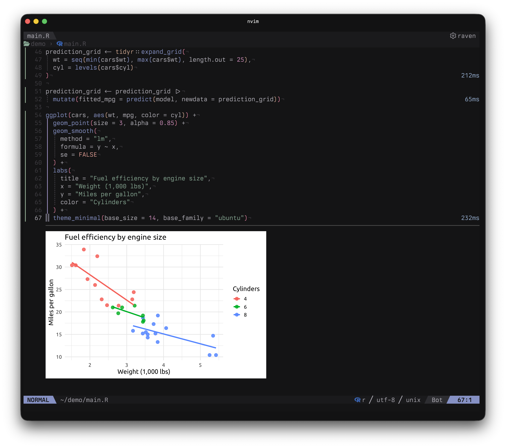
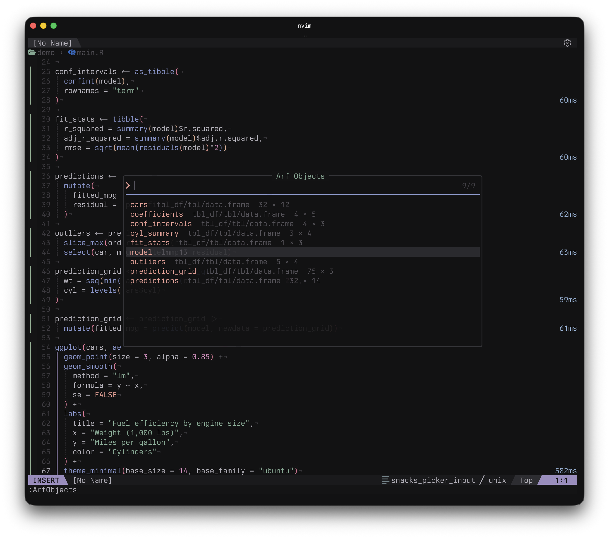
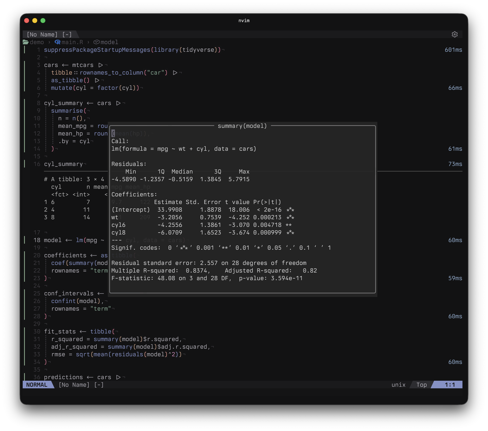

# arf.nvim

<p align="center">
  
</p>

[English](README.md) | 日本語

**R のコードと実行結果を、Neovim の同じバッファで。**

`.R` ファイルから式を実行し、テキストとプロットをコード直下に表示します。
バックエンドには [arf](https://github.com/eitsupi/arf) を使います。

<p align="center">
  
</p>

- 式単位・選択範囲・バッファ全体を実行。
- R セッションを自動起動し、実行の間でオブジェクトを保持。
- 保存した出力の確認、オブジェクトの検査、プロットのコピー。
- 結果は仮想行に表示し、ソースファイルはそのまま。

## Requirements

- **Neovim 0.12+**、**R**、PATH に通した **[arf](https://github.com/eitsupi/arf) 0.7.0-beta.2 以降**。
- 式の自動選択・バッファ全体の実行には **R の Tree-sitter パーサー**。
- インライン画像には `image` を有効にした **[Snacks](https://github.com/folke/snacks.nvim)**、**ImageMagick**、**Ghostty** や **Kitty** などの対応ターミナル。

## Installation

[lazy.nvim](https://github.com/folke/lazy.nvim) の設定に追加します。

```lua
return {
  "topazape/arf.nvim",
  version = "*",
  ft = "r",
  dependencies = {
    { "folke/snacks.nvim", opts = { image = { enabled = true } } },
  },
  opts = {},
  keys = {
    { "<LocalLeader>fr", "<Cmd>ArfRun<CR>", ft = "r", desc = "Run R expression" },
    { "<LocalLeader>fr", ":ArfRun<CR>", mode = "x", ft = "r", desc = "Run selected lines" },
    { "<LocalLeader>fc", "<Cmd>ArfClear<CR>", ft = "r", desc = "Clear results" },
    { "<LocalLeader>fo", "<Cmd>ArfOutput<CR>", ft = "r", desc = "Open saved output" },
    { "<LocalLeader>fi", "<Cmd>ArfInterrupt<CR>", ft = "r", desc = "Interrupt R" },
  },
}
```

Snacks を設定済みなら、既存のオプションに `image = { enabled = true }` を追加してください。

## First run

R プロジェクトのディレクトリで `.R` ファイルを開きます。

```r
x <- mtcars
head(x)
plot(x$mpg, x$wt)
```

各行にカーソルを置き、上から順に `<LocalLeader>fr` を押します。初回に R が自動起動し、以降は同じセッションを使います。代入だけの式は通常テキストを出力しません。

`<LocalLeader>` の既定値は `\` なので、実際のキーは `\fr` です。Visual モードで行を選択すると、同じキーでその範囲を実行できます。

- `<LocalLeader>fo`：カーソル位置の保存済み出力を開く。`/` で検索、`y` でコピー、`q` で閉じる。
- `<LocalLeader>fc`：結果を消す。R のオブジェクトは保持。
- `<LocalLeader>fi`：セッションを保持して実行を中断。

ほかの操作：

- `:ArfRunAll`：バッファ全体を実行。
- `:ArfCopyPlot`：最後の保存済みプロットをコピー。
- `:ArfStop`：自動起動したセッションを終了し、結果を消す。

## Inspect objects

`:ArfObjects` で、現在の R セッションのオブジェクトを Snacks.picker から探せます。
`<CR>` でサマリーを表示し、通常モードの `p` で選んだオブジェクトを出力します。

<p align="center">
  
</p>

オブジェクト名にカーソルを置いて `:ArfSummary` を使えば、直接確認できます。結果は `q` で閉じます。

<p align="center">
  
</p>

## Configuration

設定なしで使えます。変更したい項目だけ、lazy.nvim の `opts` に指定してください。

```lua
opts = {
  inline = { max_lines = 10 },
  float_window = { width = "80%" },
  output = { tibble = { max_rows = 100 } },
}
```

全設定・コマンド・独自のオブジェクト検査・困ったときの対処は、[ヘルプ](doc/arf.txt)（`:help arf`）を参照してください。全設定の既定値は `:help arf-configuration` にあります。

## Project philosophy

自分の R 作業のために、AI と vibe coding で作りました。小さく保つ方針です。必要に応じて fork して育ててください。

## License

[MIT ライセンス](LICENSE) © 2026 topazape.
