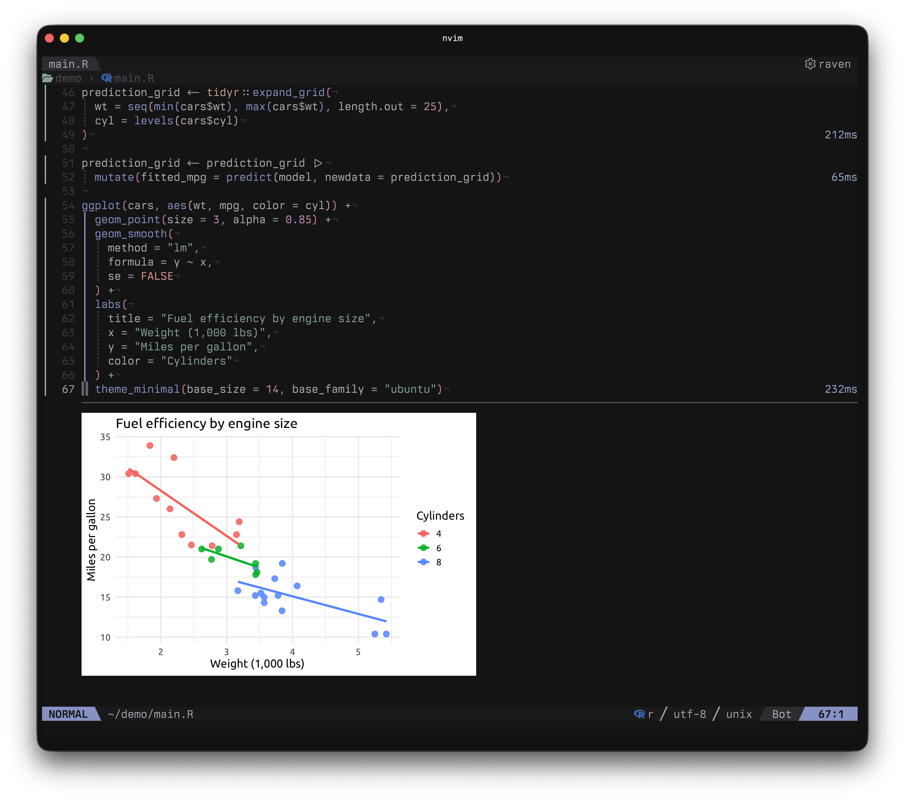
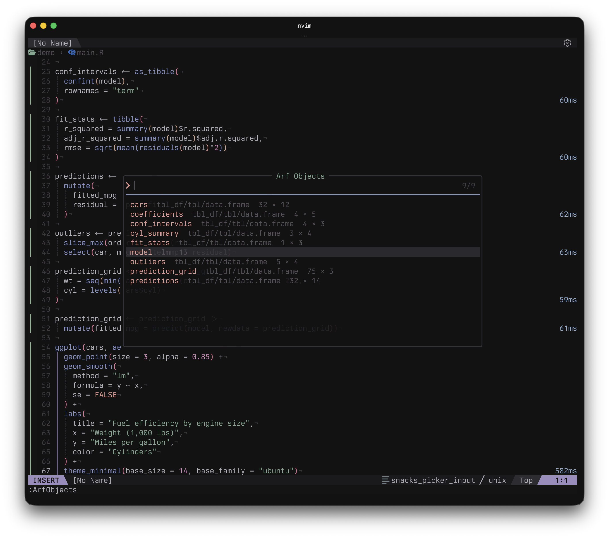
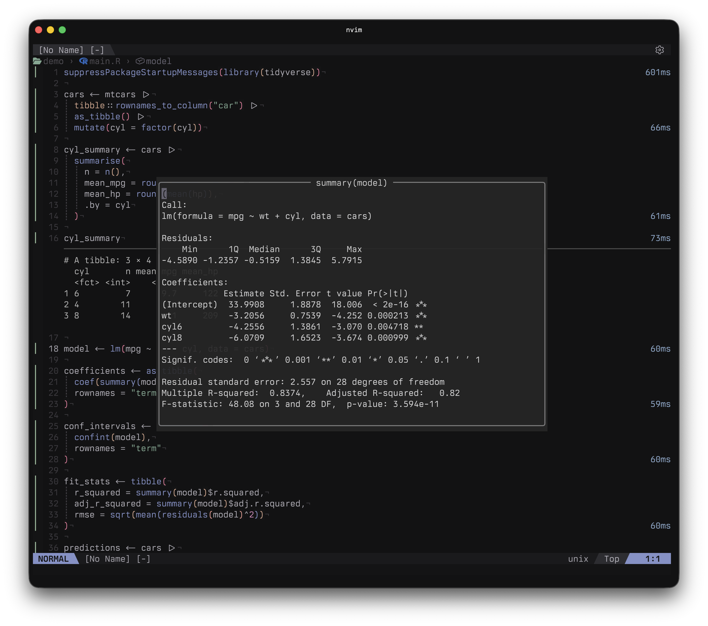

# arf.nvim

<p align="center">
  
</p>

English | [日本語](README.ja.md)

**R code and results, together in Neovim.**

A Neovim plugin powered by [arf](https://github.com/eitsupi/arf). Run expressions from `.R` files and view text and plots directly below your code, without writing output into the source file.

[Features](#features) · [Comparison](#comparison-with-related-plugins) · [Requirements](#requirements) · [Installation](#installation) · [Usage](#usage) · [Limitations](#limitations) · [Troubleshooting](#troubleshooting)

<p align="center">
  
</p>

## Features

- **Run expressions or the whole buffer** — Tree-sitter identifies pipelines, ggplot expressions, function definitions, and more. Visual selections and explicit line ranges work too.
- **Inline results** — Display text and plots below the code, stacking multiple images in generation order and keeping results from other ranges. Copy the latest plot to the clipboard.
- **Persistent R session** — Start a session automatically on first execution and reuse objects across runs.
- **Read longer output** — Keep inline previews short, then search and copy the rest with `ArfOutput`. Configure how many tibble rows to print.
- **Object inspection** — Call `summary()` or another R function on the object under the cursor.
- **Execution signs** — An animated spinner, success and error icons, and configurable symbols and colors.

## Comparison with related plugins

Choose **arf.nvim** when you mainly work in `.R` scripts and want each expression's text and plots directly below the code. It uses arf's headless R session over IPC, with R-aware expression selection and inline results; Jupyter and IRkernel are not required.

- **[R.nvim](https://github.com/R-nvim/R.nvim)** provides a broader R environment: terminal/tmux communication, completion, an object browser, R help, and Quarto/R Markdown support. Choose it for an integrated R editing and console workflow; arf.nvim focuses on evaluating scripts and reading results beside the source.
- **[iron.nvim](https://github.com/Vigemus/iron.nvim)** sends code to configurable REPLs across languages. Choose it to work with an interactive REPL; arf.nvim attaches text and plot results to the executed R source ranges.
- **[molten.nvim](https://github.com/benlubas/molten-nvim)** runs code through Jupyter kernels, using [IRkernel](https://irkernel.github.io/) for R. It also supports inline output and images, plus saving/loading cells and outputs and notebook output import/export. Choose it for a Jupyter-based workflow; arf.nvim uses arf directly and does not save results across sessions.
- **[quarto-nvim](https://github.com/quarto-dev/quarto-nvim)** focuses on Quarto manuscripts, with preview, embedded-language support, and code execution delegated to runners such as Molten or iron. Choose it for `.qmd` authoring; arf.nvim focuses on `.R` scripts.

arf.nvim does not provide completion or a language server. Inline plots require Snacks and a compatible terminal; see Requirements below.

## Requirements

- **Neovim 0.12+**
- **R and [arf](https://github.com/eitsupi/arf)** — Follow arf's installation instructions and put `arf` on your PATH, or configure its executable path. Tested with arf 0.6.0.
- **R Tree-sitter parser** — Required for `ArfRun` expression detection in Normal mode and for `ArfRunAll`. Install `r` using your parser manager. Visual selections and explicit line ranges do not require the parser.

Inline plots additionally require:

- [snacks.nvim](https://github.com/folke/snacks.nvim) with `image` enabled. Tested with the placement API in version 2.31.0.
- **A compatible terminal**, such as Ghostty or Kitty, supporting inline images through the Kitty Graphics Protocol.
- **ImageMagick** — Snacks uses `magick` or `identify` to read image sizes.

Copying plots with `ArfCopyPlot` requires `osascript` on macOS, `wl-copy` (Wayland) or `xclip` (X11) on Linux, or PowerShell on Windows.

## Installation

### lazy.nvim

Add this spec to your lazy.nvim configuration:

```lua
return {
  "topazape/arf.nvim",
  version = "*",
  ft = "r",
  cmd = { "ArfRun", "ArfRunAll", "ArfClear", "ArfSummary", "ArfObjects", "ArfOutput", "ArfCopyPlot", "ArfStop" },
  dependencies = {
    {
      "folke/snacks.nvim",
      opts = { image = { enabled = true } },
    },
  },
  opts = {},
  keys = {
    { "<LocalLeader>fr", "<Cmd>ArfRun<CR>", ft = "r", desc = "Run R expression" },
    { "<LocalLeader>fr", ":ArfRun<CR>", mode = "x", ft = "r", desc = "Run selected R lines" },
    { "<LocalLeader>fR", "<Cmd>ArfRunAll<CR>", ft = "r", desc = "Run all R expressions" },
    { "<LocalLeader>fc", "<Cmd>ArfClear<CR>", ft = "r", desc = "Clear R results" },
    { "<LocalLeader>fs", "<Cmd>ArfStop<CR>", ft = "r", desc = "Stop R session" },
    { "<LocalLeader>fo", "<Cmd>ArfOutput<CR>", ft = "r", desc = "Show saved R output" },
    { "<LocalLeader>fy", "<Cmd>ArfCopyPlot<CR>", ft = "r", desc = "Copy latest plot" },
    { "<LocalLeader>fk", "<Cmd>ArfSummary<CR>", ft = "r", desc = "Show R object summary" },
  },
}
```

If you already configure Snacks, add `image = { enabled = true }` to its options. You can omit `dependencies` if you use neither inline plots nor the Object Picker.

## Usage

1. Start Neovim in your R project's working directory and open an `.R` file.
2. Place the cursor in an expression and press `<LocalLeader>fr`.
3. Read the results below the code. To run selected lines instead, make a Visual selection and press the same keys.

```r
x <- mtcars

head(x)

plot(
  x$mpg, x$wt,
  xlab = "Miles per gallon",
  ylab = "Weight (1000 lbs)"
)

model <- lm(mpg ~ wt, data = x)
plot(model)
```

Assignments normally produce no text output. Run `x <- mtcars` first, then `head(x)` or `plot(...)`. Place the cursor on `x` and press `<LocalLeader>fk` to open its summary; press `q` to close the float.

Run `model <- ...` followed by `plot(model)` to display four diagnostic plots vertically.

Unless `pid` selects an external session, `arf headless` starts automatically on the first evaluation; no manual session startup is needed. To run the whole buffer, press `<LocalLeader>fR` or use `:ArfRunAll`.

### Read longer output

Place the cursor within an executed range and press `<LocalLeader>fo` or run `:ArfOutput` to open saved text without recomputing. Use `/` to search, `y` to copy, `zl` / `zh` to scroll horizontally, and `q` to close.

Rows or columns omitted by R and text exceeding the retention limit are unavailable. Change the [output settings](doc/arf.txt) (`:help arf-output-settings`) and rerun to include them.

### Keymaps

The plugin does not register R buffer keymaps automatically. The Installation example registers keys through lazy.nvim; see [Commands](#commands) for their actions.

`<LocalLeader>` follows `vim.g.maplocalleader` and defaults to backslash: `\fr` to run and `\fc` to clear. To use a comma, set it before the plugin loads:

```lua
vim.g.maplocalleader = "," -- ,fr to run, ,fc to clear
```

Customize the lazy.nvim `keys` entries in Installation or use `vim.keymap.set()`. The Visual mapping uses `:ArfRun<CR>` to pass complete selected lines.

### Commands

These commands are available directly; the keys shown are configured by the Installation example:

| Command | Example key | Action |
| --- | --- | --- |
| `:ArfRun` | `<LocalLeader>fr` | Run the current expression in Normal mode or complete selected lines in Visual mode. Use `:3,5ArfRun` to run complete lines in an explicit range. |
| `:ArfRunAll` | `<LocalLeader>fR` | Run every top-level expression in the current buffer in order, displaying results below each expression. |
| `:ArfClear` | `<LocalLeader>fc` | Remove output, images, and signs from the current buffer; keep R objects. |
| `:ArfObjects` | — | Search and inspect objects in the current R session. |
| `:ArfSummary` | `<LocalLeader>fk` | Call `base::summary()` on the object under the cursor and show it in a float. |
| `:ArfOutput` | `<LocalLeader>fo` | Open saved output for the execution range under the cursor without evaluating R again. |
| `:ArfCopyPlot` | `<LocalLeader>fy` | Copy the most recently generated saved plot image to the clipboard. |
| `:ArfStop` | `<LocalLeader>fs` | Terminate the automatically started arf session, even during execution, and clear results and signs in all buffers. The next evaluation starts a fresh session. With an explicit `pid`, warn without changing anything. |

`:ArfCopyPlot` searches all buffers and copies the last image of the most recent plot result. Cleared or replaced results are not copied.

### Object Picker

<p align="center">
  
  <br>
  <em>Search and select objects in the current R session.</em>
</p>

Use `:ArfObjects` or `require("arf").objects()` to fuzzy search names in the current session's `.GlobalEnv` with Snacks.picker. Rows show the name, class, and dimensions or length when available. This feature requires Snacks.picker.

- Type a name in insert mode; `<CR>` runs `summary()`. Press `<Esc>` to enter normal mode.
- In normal mode, `p` runs `print()`, `r` refreshes the list, and `q` closes it.
- Results use the existing float. `ArfOutput` separately reopens saved execution output.
- The list reflects the session when the Picker opens. Dot-prefixed names are omitted.

### Object inspection

<p align="center">
  
  <br>
  <em>Inspect a model summary alongside your code.</em>
</p>

To call an R function on the object under the cursor and show its text output in a float, add a callback to your keymaps:

```lua
-- Add this entry to the lazy.nvim `keys` table above.
{
  "<LocalLeader>fp",
  function()
    require("arf").inspect("performance::model_performance", {
      title = "Model performance",
    })
  end,
  ft = "r",
  desc = "Inspect model performance",
},
```

Run the expression that creates the object first, then place the cursor on its name.

Object inspection (including summary) resolves the name under the cursor (including dots) in the global environment and inherited environments. It does not evaluate member/index expressions or whole names containing spaces/operators: on `column` in `df$column`, it looks up a separate object named `column`.

`inspect(fn, opts)` accepts an ASCII R function name or an exported `package::function`; R code can be supplied explicitly with `{ r = [[ ... ]] }`. Install the package before using a namespace-qualified function; `library()` is unnecessary. Plots are not displayed.

`title` is optional and defaults to `function(object)`, such as `summary(x)`, or `inspect(object)` for `{ r = ... }`.

The function receives the object under the cursor as its only argument. Use an anonymous R function to supply extra arguments. Errors appear in the float.

```lua
require("arf").inspect({
  r = [[
    function(x) {
      stats::confint(x, level = 0.90)
    }
  ]],
}, { title = "90% confidence interval" })
```

Supply trusted R code. Functions already defined in the R session can also be passed by name, such as `inspect("inspect_ci")`.

### Execution and sessions

- Automatic selection requires a syntactically complete buffer. Inside a function or loop, it selects the whole definition or loop; expressions sharing a line are selected by cursor position. Blank lines and comments outside expressions have nothing to run.
- `ArfRun` / `ArfRunAll` show per-expression wall-clock time, including IPC and result processing but excluding initial session startup.
- `ArfRunAll` runs top-level expressions in the existing session, stopping at the first R error or IPC failure. Completed results and existing results not reached remain. `:%ArfRun` evaluates the buffer as one range, with combined output at the end.
- Results appear below the executed range. Editing keeps the previous output dimmed and removes execution signs. Rerunning replaces the result; deleting the entire range removes it. Other ranges do not update automatically: rerun dependent expressions after changing data or variables.
- Editing, clearing, or unloading the source buffer while evaluation is pending discards its result and stops subsequent expressions, without interrupting R.
- All buffers in a Neovim instance share one R session. Automatically started sessions use `:pwd` at the first evaluation; later `:cd` changes do not affect R. External sessions retain their existing working directory. Neovim exits stop only automatically started sessions.

For detailed configuration, the Lua API, highlights, and renamed settings, see the [help](doc/arf.txt) (`:help arf`).

## Limitations

- One evaluation at a time; additional runs and inspections are rejected throughout `ArfRunAll`. Output appears after each evaluation, without streaming or resuming interrupted computations.
- Results are tracked by line range. Running another expression on the same line replaces the previous result.
- Results cannot be saved/restored across sessions. Text retention limits apply per evaluation; there is no total limit across results or limit on image count or total image size.
- stdout precedes stderr, losing their interleaving.

## Troubleshooting

- **No image appears:** run `:checkhealth snacks` to check dependencies and terminal detection. `:echo executable('magick')` or `:echo executable('identify')` returns `1` when the command is available.
- **An expression will not run:** check the R Tree-sitter parser and buffer syntax. Visual selections and `:3,5ArfRun` work without a parser.
- **Keymaps do not work:** check that you added the `keys` configuration, that the buffer filetype is `r`, and that `maplocalleader` is set before the keymaps are registered.
- **Output is missing:** place the cursor within the executed code range and open `:ArfOutput`. For tibble omissions or discarded output, change the [output settings](doc/arf.txt) (`:help arf-output-settings`) and rerun.
- **`object not found`:** run the expression that creates the variable first. A session started after `:ArfStop` has none of the previous session's objects.
- **A relative file path fails:** run `getwd()` in R. Neovim's `:cd` does not change an existing R session's directory. Use `setwd()` in R, or use `:ArfStop` to end the automatically started session, change Neovim's directory, and rerun.
- **A computation will not finish:** `:ArfStop` terminates the automatically started session. Its R objects will be lost. Stop an external session selected with `pid` from that session instead.

## Project philosophy

Built with AI-assisted “vibe coding” for my own R workflow. It already does what I need, so I’m keeping the scope small. If you’d like additional features, feel free to fork it and make it your own.

## License

[MIT](LICENSE) © 2026 topazape.
