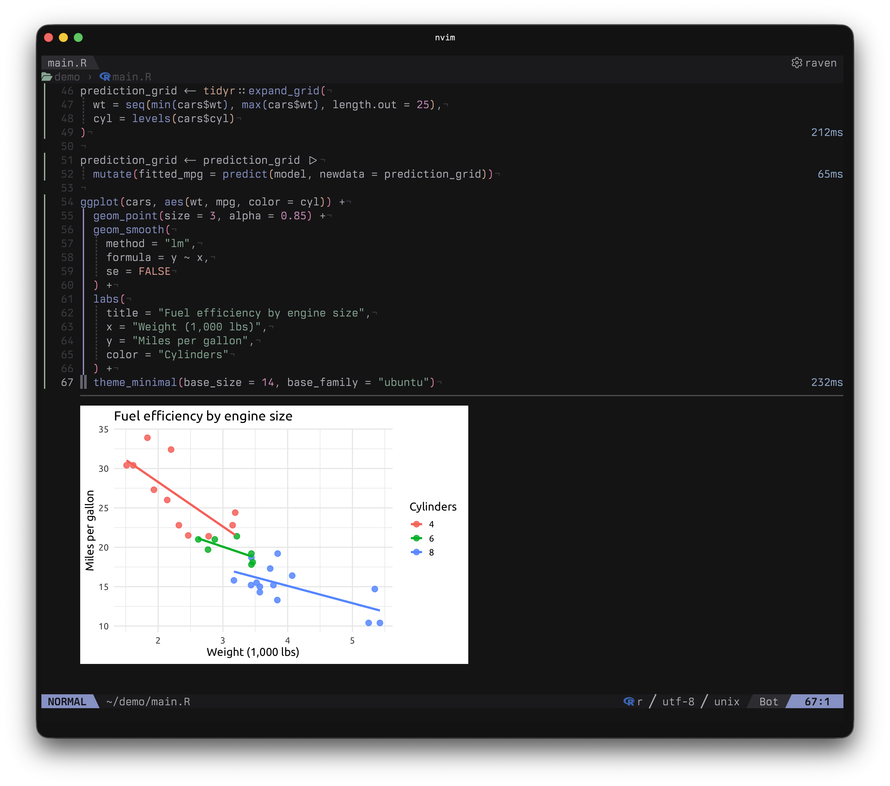
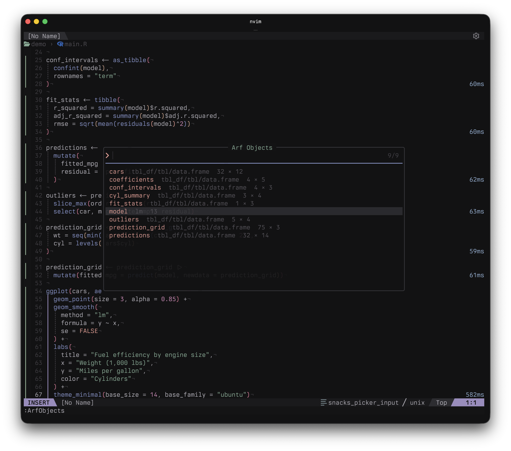
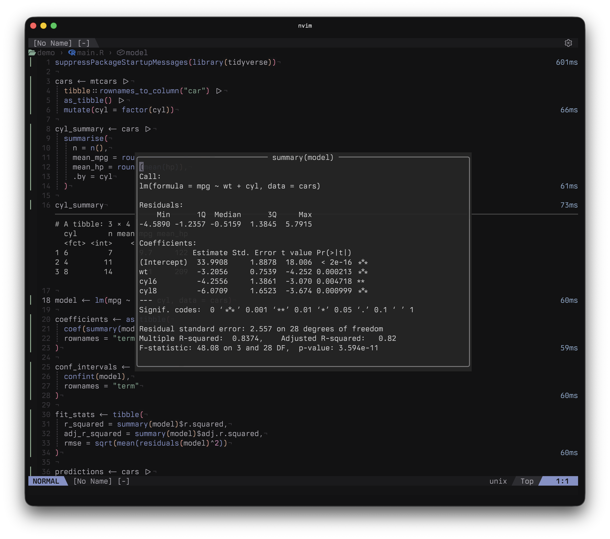

# arf.nvim

<p align="center">
  
</p>

English | [日本語](README.ja.md)

**R code and results, together in Neovim.**

Run expressions from `.R` files and see text and plots directly below your code.
Powered by [arf](https://github.com/eitsupi/arf).

<p align="center">
  
</p>

- Run an expression, selected lines, or the whole buffer.
- Keep R objects between runs with an automatically started session.
- Read saved output, inspect objects, and copy plots.
- Keep source files untouched; results live in virtual lines.

## Requirements

- **Neovim 0.12+**, **R**, and **[arf](https://github.com/eitsupi/arf) 0.7.0-beta.2+** on your PATH.
- **R Tree-sitter parser** for expression selection and running the whole buffer.
- For inline plots: **[Snacks](https://github.com/folke/snacks.nvim)** with `image` enabled, **ImageMagick**, and a compatible terminal such as **Ghostty** or **Kitty**.

## Installation

With [lazy.nvim](https://github.com/folke/lazy.nvim):

```lua
return {
  "topazape/arf.nvim",
  version = "*",
  ft = "r",
  dependencies = {
    { "folke/snacks.nvim", opts = { image = { enabled = true } } },
  },
  opts = {},
  keys = {
    { "<LocalLeader>fr", "<Cmd>ArfRun<CR>", ft = "r", desc = "Run R expression" },
    { "<LocalLeader>fr", ":ArfRun<CR>", mode = "x", ft = "r", desc = "Run selected lines" },
    { "<LocalLeader>fc", "<Cmd>ArfClear<CR>", ft = "r", desc = "Clear results" },
    { "<LocalLeader>fo", "<Cmd>ArfOutput<CR>", ft = "r", desc = "Open saved output" },
    { "<LocalLeader>fi", "<Cmd>ArfInterrupt<CR>", ft = "r", desc = "Interrupt R" },
  },
}
```

Already use Snacks? Add `image = { enabled = true }` to its existing options.

## First run

Open an `.R` file in your R project's directory:

```r
x <- mtcars
head(x)
plot(x$mpg, x$wt)
```

Place the cursor on each line and press `<LocalLeader>fr` in order. The first run starts R automatically; later runs reuse the session. Assignments usually produce no text.

`<LocalLeader>` defaults to `\`: press `\fr` to run. Select lines in Visual mode and use the same keys to run a range.

- `<LocalLeader>fo` opens saved text at the cursor. Search with `/`, copy with `y`, and close with `q`.
- `<LocalLeader>fc` clears results; R objects remain.
- `<LocalLeader>fi` interrupts evaluation while keeping the session.

To go further:

- `:ArfRunAll` runs the whole buffer.
- `:ArfCopyPlot` copies the latest saved plot.
- `:ArfStop` ends the automatically started session and clears its results.

## Inspect objects

Use `:ArfObjects` to search objects in the current R session with Snacks.picker.
Press `<CR>` for a summary or `p` in Normal mode to print the selected object.

<p align="center">
  
</p>

Use `:ArfSummary` on an object name to inspect it directly. Press `q` to close the result.

<p align="center">
  
</p>

## Configuration

Defaults work without configuration. Change only what you need in the lazy.nvim `opts` table:

```lua
opts = {
  inline = { max_lines = 10, border = "rounded" },
  float_window = { width = "80%" },
  output = { tibble = { max_rows = 100 } },
}
```

<details>
<summary>All options and defaults</summary>

```lua
require("arf").setup({
  executable = "arf",
  pid = nil,                -- omitted: auto-start; number: external; false: reset
  startup_timeout_ms = 10000, -- 10 seconds
  eval_timeout_ms = 300000, -- 5 minutes per evaluation

  output = {
    max_bytes = 1048576,      -- retained text per evaluation, including errors
    tibble = {
      max_rows = "inherit",     -- "inherit" or a positive integer
      width = "auto",           -- "inherit", "auto", positive integer, or "all"
    },
  },

  inline = {
    max_lines = 20,           -- body lines, excluding borders, notices, and images
    border = "line",          -- "rounded", "single", "double", "line", or "none"
  },

  float_window = {          -- shared by saved output and object inspections
    width = "60%",            -- "auto", positive integer, or "1%" to "100%"
    max_height = 30,
  },

  image = {
    render = {                -- PNG generated by R
      width_px = 1200,
      height_px = 800,
      dpi = 180,
    },
    display = {               -- display limits in terminal cells
      max_width = 100,          -- columns
      max_height = 30,          -- rows
    },
  },

  theme = "default",        -- "default", "auto", or "neon"

  signs = {
    enabled = true,
    priority = 5,
    range = { text = "│" },
    success = { text = "│", hl = "ArfSignSuccess" },
    error = { text = "│", hl = "ArfSignError" },
    interrupted = { text = "│", hl = "ArfSignInterrupted" },
    running = {
      text = "…",               -- static symbol when animation is disabled
      hl = "ArfSignRunning",
      frames = { "⠋", "⠙", "⠹", "⠸", "⠼", "⠴", "⠦", "⠧", "⠇", "⠏" },
      interval_ms = 80,         -- milliseconds
    },
  },
})
```

</details>

`inline.border` accepts `"line"` (default), `"single"`, `"rounded"`, `"double"`, or `"none"`. Enclosed previews clip long lines to fit the narrowest window showing the buffer in the current tab. Open `:ArfOutput` to read the full retained text.

When updating an existing configuration:

- Rename `startup_timeout` and `eval_timeout` to `startup_timeout_ms` and `eval_timeout_ms`.
- Rename `signs.running.interval` to `signs.running.interval_ms`. Values remain in milliseconds.
- Replace `false` with `"inherit"` for `output.tibble.max_rows` and `output.tibble.width` to preserve R's settings. Old names and values are rejected.

See [the help](doc/arf.txt) (`:help arf`) for all settings, commands, custom inspection, and troubleshooting. Full defaults: `:help arf-configuration`.

## Project philosophy

Built with AI-assisted “vibe coding” for my own R workflow. I’m keeping the scope small; feel free to fork it for your own needs.

## License

[MIT](LICENSE) © 2026 topazape.
