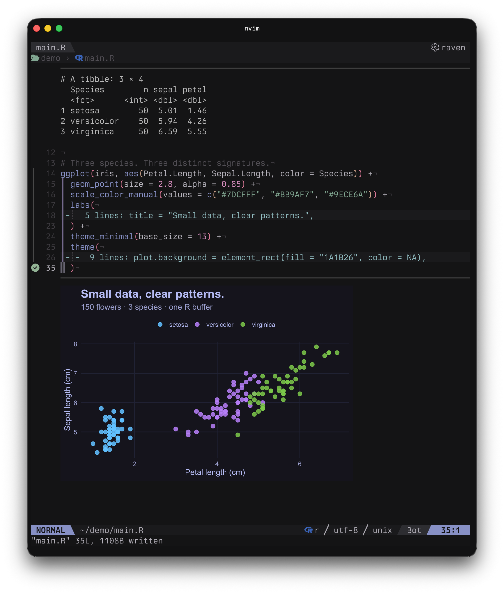

# arf.nvim

<p align="center">
  
</p>

English | [日本語](README.ja.md)

**R code and results, together in Neovim.**

A Neovim plugin powered by [arf](https://github.com/eitsupi/arf). Run expressions from `.R` files and view text and plots directly below your code, without writing output into the source file.

[Features](#features) · [Requirements](#requirements) · [Installation](#installation) · [Usage](#usage) · [Configuration](#configuration) · [API](#api) · [Highlights](#highlights) · [Limitations](#limitations) · [Troubleshooting](#troubleshooting)

<p align="center">
  
</p>

## Features

- **Run expressions or the whole buffer** — Tree-sitter identifies pipelines, ggplot expressions, function definitions, and more. Visual selections and explicit line ranges work too.
- **Inline results** — Display text and plots below the code, stacking multiple images in generation order and keeping results from other ranges. Copy the latest plot to the clipboard.
- **Persistent R session** — Start a session automatically on first execution and reuse objects across runs.
- **Read longer output** — Keep inline previews short, then search and copy the rest with `ArfOutput`. Configure how many tibble rows to print.
- **Object inspection** — Call `summary()` or another R function on the object under the cursor.
- **Execution signs** — An animated spinner, success and error icons, and configurable symbols and colors.

## Requirements

- **Neovim 0.12+**
- **R and [arf](https://github.com/eitsupi/arf)** — Follow arf's installation instructions and put `arf` on your PATH, or configure its executable path. Tested with arf 0.6.0.
- **R Tree-sitter parser** — Required for `ArfRun` expression detection in Normal mode and for `ArfRunAll`. Install `r` using your parser manager. Visual selections and explicit line ranges do not require the parser.

Inline plots additionally require:

- [snacks.nvim](https://github.com/folke/snacks.nvim) with `image` enabled. Tested with the placement API in version 2.31.0.
- **A compatible terminal**, such as Ghostty or Kitty, supporting inline images through the Kitty Graphics Protocol.
- **ImageMagick** — Snacks uses `magick` or `identify` to read image sizes.

Copying plots with `ArfCopyPlot` requires `osascript` on macOS, `wl-copy` (Wayland) or `xclip` (X11) on Linux, or PowerShell on Windows.

## Installation

### lazy.nvim

Add this spec to your lazy.nvim configuration:

```lua
return {
  "topazape/arf.nvim",
  version = "*",
  ft = "r",
  cmd = { "ArfRun", "ArfRunAll", "ArfClear", "ArfSummary", "ArfOutput", "ArfCopyPlot", "ArfStop" },
  dependencies = {
    {
      "folke/snacks.nvim",
      opts = { image = { enabled = true } },
    },
  },
  opts = {},
  keys = {
    { "<LocalLeader>fr", "<Cmd>ArfRun<CR>", ft = "r", desc = "Run R expression" },
    { "<LocalLeader>fr", ":ArfRun<CR>", mode = "x", ft = "r", desc = "Run selected R lines" },
    { "<LocalLeader>fR", "<Cmd>ArfRunAll<CR>", ft = "r", desc = "Run all R expressions" },
    { "<LocalLeader>fc", "<Cmd>ArfClear<CR>", ft = "r", desc = "Clear R results" },
    { "<LocalLeader>fs", "<Cmd>ArfStop<CR>", ft = "r", desc = "Stop R session" },
    { "<LocalLeader>fo", "<Cmd>ArfOutput<CR>", ft = "r", desc = "Show saved R output" },
    { "<LocalLeader>fy", "<Cmd>ArfCopyPlot<CR>", ft = "r", desc = "Copy latest plot" },
    { "<LocalLeader>fk", "<Cmd>ArfSummary<CR>", ft = "r", desc = "Show R object summary" },
  },
}
```

If you already configure Snacks, add `image = { enabled = true }` to its options. You can omit `dependencies` when using text output only.

## Usage

1. Start Neovim in your R project's working directory and open an `.R` file.
2. Place the cursor in an expression and press `<LocalLeader>fr`.
3. Read the results below the code. To run selected lines instead, make a Visual selection and press the same keys.

```r
x <- mtcars

head(x)

plot(
  x$mpg, x$wt,
  xlab = "Miles per gallon",
  ylab = "Weight (1000 lbs)"
)

model <- lm(mpg ~ wt, data = x)
plot(model)
```

Assignments normally produce no text output. Run `x <- mtcars` first, then `head(x)` or `plot(...)`. Place the cursor on `x` and press `<LocalLeader>fk` to open its summary; press `q` to close the float.

Run `model <- ...` followed by `plot(model)` to display four diagnostic plots vertically.

Unless `pid` selects an external session, `arf headless` starts automatically on the first evaluation; no manual session startup is needed. To run the whole buffer, press `<LocalLeader>fR` or use `:ArfRunAll`.

### Read longer output

Place the cursor within an executed range and press `<LocalLeader>fo` or run `:ArfOutput` to open saved text without recomputing. Use `/` to search, `y` to copy, `zl` / `zh` to scroll horizontally, and `q` to close.

Rows or columns omitted by R and text exceeding the retention limit are unavailable. Change the [output settings](#output-and-floats) and rerun to include them.

### Keymaps

The plugin does not register R buffer keymaps automatically. The Installation example registers keys through lazy.nvim; see [Commands](#commands) for their actions.

`<LocalLeader>` follows `vim.g.maplocalleader` and defaults to backslash: `\fr` to run and `\fc` to clear. To use a comma, set it before the plugin loads:

```lua
vim.g.maplocalleader = "," -- ,fr to run, ,fc to clear
```

Customize the lazy.nvim `keys` entries in Installation or use `vim.keymap.set()`. The Visual mapping uses `:ArfRun<CR>` to pass complete selected lines.

### Commands

These commands are available directly; the keys shown are configured by the Installation example:

| Command | Example key | Action |
| --- | --- | --- |
| `:ArfRun` | `<LocalLeader>fr` | Run the current expression in Normal mode or complete selected lines in Visual mode. Use `:3,5ArfRun` to run complete lines in an explicit range. |
| `:ArfRunAll` | `<LocalLeader>fR` | Run every top-level expression in the current buffer in order, displaying results below each expression. |
| `:ArfClear` | `<LocalLeader>fc` | Remove output, images, and signs from the current buffer; keep R objects. |
| `:ArfSummary` | `<LocalLeader>fk` | Call `base::summary()` on the object under the cursor and show it in a float. |
| `:ArfOutput` | `<LocalLeader>fo` | Open saved output for the execution range under the cursor without evaluating R again. |
| `:ArfCopyPlot` | `<LocalLeader>fy` | Copy the most recently generated saved plot image to the clipboard. |
| `:ArfStop` | `<LocalLeader>fs` | Terminate the automatically started arf session, even during execution, and clear results and signs in all buffers. The next evaluation starts a fresh session. With an explicit `pid`, warn without changing anything. |

`:ArfCopyPlot` searches all buffers and copies the last image of the most recent plot result. Cleared or replaced results are not copied.

### Object inspection

To call an R function on the object under the cursor and show its text output in a float, add a callback to your keymaps:

```lua
-- Add this entry to the lazy.nvim `keys` table above.
{
  "<LocalLeader>fp",
  function()
    require("arf").inspect("performance::model_performance", {
      title = "Model performance",
    })
  end,
  ft = "r",
  desc = "Inspect model performance",
},
```

Run the expression that creates the object first, then place the cursor on its name.

Object inspection (including summary) resolves the name under the cursor (including dots) in the global environment and inherited environments. It does not evaluate member/index expressions or whole names containing spaces/operators: on `column` in `df$column`, it looks up a separate object named `column`.

`inspect(fn, opts)` accepts an ASCII R function name or an exported `package::function`; R code can be supplied explicitly with `{ r = [[ ... ]] }`. Install the package before using a namespace-qualified function; `library()` is unnecessary. Plots are not displayed.

`title` is optional and defaults to `function(object)`, such as `summary(x)`, or `inspect(object)` for `{ r = ... }`.

The function receives the object under the cursor as its only argument. Use an anonymous R function to supply extra arguments. Errors appear in the float.

```lua
require("arf").inspect({
  r = [[
    function(x) {
      stats::confint(x, level = 0.90)
    }
  ]],
}, { title = "90% confidence interval" })
```

Supply trusted R code. Functions already defined in the R session can also be passed by name, such as `inspect("inspect_ci")`.

### Execution and sessions

- Automatic selection requires a syntactically complete buffer. Inside a function or loop, it selects the whole definition or loop; expressions sharing a line are selected by cursor position. Blank lines and comments outside expressions have nothing to run.
- `ArfRunAll` runs top-level expressions in the existing session, stopping at the first R error or IPC failure. Completed results and existing results not reached remain. `:%ArfRun` evaluates the buffer as one range, with combined output at the end.
- Results appear below the executed range. Editing keeps the previous output dimmed and removes execution signs. Rerunning replaces the result; deleting the entire range removes it. Other ranges do not update automatically: rerun dependent expressions after changing data or variables.
- Editing, clearing, or unloading the source buffer while evaluation is pending discards its result and stops subsequent expressions, without interrupting R.
- All buffers in a Neovim instance share one R session. Automatically started sessions use `:pwd` at the first evaluation; later `:cd` changes do not affect R. External sessions retain their existing working directory. Neovim exits stop only automatically started sessions.

## Configuration

Set only the options you want to change, using `opts` in your lazy.nvim spec. Nested `signs` options merge individually. Repeated calls to `setup()` merge the supplied options into the current configuration.

<details>
<summary>All options and defaults</summary>

```lua
require("arf").setup({
  theme = "default",          -- "default", "auto", or "neon"

  -- arf / R session
  executable = "arf",         -- Command name or executable path
  pid = nil,                  -- nil: start a session; number: use an existing session
  startup_timeout = 10000,    -- Session startup timeout in milliseconds
  eval_timeout = 300000,      -- IPC response timeout in milliseconds

  -- Image display limits in terminal cells
  image_max_width = 100,      -- Maximum columns
  image_max_height = 30,      -- Maximum rows

  -- PNG generated by R
  plot_width_px = 1200,       -- Width in pixels
  plot_height_px = 800,       -- Height in pixels
  plot_dpi = 180,             -- DPI; also affects text and line sizes

  -- Output display and retention
  tibble_max_rows = false,    -- Set a positive integer to override tibble row printing
  tibble_width = "auto",      -- false, "auto", positive integer, or "all"
  inline_max_lines = 20,      -- Inline body lines, excluding notices and images
  output_max_bytes = 1048576, -- Retained bytes per run, including errors (1 MiB)
  -- Shared by ArfOutput and object inspections
  float_width = "60%",        -- "auto", positive integer, or "1%" to "100%"
  float_max_height = 30,      -- Maximum rows; shrinks for short output

  -- Execution signs
  signs = {
    enabled = true,           -- Set false to hide all execution signs
    priority = 5,             -- Higher values take precedence
    range = { text = "│", hl = "ArfSignRange" },
    success = { text = "│", hl = "ArfSignSuccess" },
    error = { text = "│", hl = "ArfSignError" },
    running = {
      text = "…",             -- Initial symbol; also used when animation is disabled
      hl = "ArfSignRunning",
      frames = { "⠋", "⠙", "⠹", "⠸", "⠼", "⠴", "⠦", "⠧", "⠇", "⠏" },
      interval = 80,          -- Frame interval in milliseconds
    },
  },
})
```

</details>

### Session

- `executable`: command name or executable path. To change the executable for a running session, use `ArfStop` and evaluate again.
- `pid`: omitted by default for automatic startup. To use an existing session, obtain its PID with `arf ipc list` and supply it as a number. Manage its lifecycle and working directory separately. `ArfStop` does not stop an external session or clear its results.
- `startup_timeout`: startup wait time. Failed or timed-out startup is retried on the next evaluation.
- `eval_timeout`: IPC response wait time for each evaluation, not for the entire `ArfRunAll` sequence. A timeout alone does not stop R computation; use `ArfStop` to terminate the owned session. Stop evaluations in an external session separately.

### Plots

Plots are stacked in generation order. `image_max_width` / `image_max_height` cap each image's display size in cells; `plot_width_px` / `plot_height_px` / `plot_dpi` set PNG dimensions in pixels and resolution in dpi. The window also constrains display size.

PNG settings take effect on re-evaluation. Increasing pixels and DPI proportionally may improve sharpness while preserving displayed text and line sizes.

### Output and floats

Set R's printed row count and the inline preview length separately in your lazy.nvim `opts`:

```lua
opts = {
  tibble_max_rows = 100,
  tibble_width = "auto",
  inline_max_lines = 20,
}
```

This prints up to 100 tibble rows and shows the first 20 lines inline. Read the rest with `:ArfOutput`.

- `inline_max_lines`: inline body lines, excluding separators, notices, and images.
- `tibble_max_rows`: maximum tibble rows to print. The default `false` preserves R's settings. For individual expressions, use `print(df, n = 100)` or `print(df, n = 100, width = Inf)` to include omitted columns too. An explicit `n` takes precedence.
- `output_max_bytes`: retained text per evaluation (default 1 MiB), including stdout, stderr, and errors but excluding images. If a retention-limit notice appears, increase it and rerun. This does not limit R's memory usage.
- `tibble_width`: `false` preserves R's settings; `"auto"` uses the source window's text width at execution start (excluding gutters); a positive integer sets the output width in characters; `"all"` prints all columns. Finite widths show one tier, omit columns that do not fit, and also set R's `width`, affecting other printed output. `"all"` may be stacked in multiple tiers by tibble. An explicit `print(..., width = ...)` takes precedence. Resizing requires re-evaluation.
- `float_width` / `float_max_height`: shared float size for saved output, summary, and other inspections. `float_width = "auto"` uses the editor width minus borders and margins when opened; a positive integer specifies columns; a string such as `"90%"` specifies a percentage of the editor width (integer 1–100%). Floats fit the screen and shrink vertically for short output. Images appear only inline.

Numeric values, including PNG settings, require positive integers. `inline_max_lines` applies on the next display refresh; float sizes apply when reopened. Changes to `tibble_max_rows`, `tibble_width`, and `output_max_bytes` require re-evaluation.

`tibble_max_rows` and `tibble_width` also apply to object inspections. The R options they set are restored after each evaluation.

### Signs

| Option | Description |
| --- | --- |
| `signs.enabled = false` | hide all execution signs. |
| `signs.range.text = ""` | hide range markers and keep only the final-line status. |
| Each `text` | a symbol occupying 1–2 display cells, or an empty string to hide it. |
| Each `hl` | a highlight group name; see [Highlights](#highlights). |
| `signs.priority` | a non-negative integer; higher values take precedence. Defaults to 5. |
| `signs.running.frames` | animation frames, each 1–2 display cells wide. Two or more frames enable animation; an empty list `{}` or a single frame uses the static `running.text` instead. |
| `signs.running.interval` | a positive frame interval in milliseconds; defaults to 80. |

By default, successful and failed ranges use `│` on every line, colored by `signs.success.hl` or `signs.error.hl`. Running ranges use `signs.running.hl` throughout, with a spinner on the last line. Nerd Font is not required. `signs.range.hl` and `ArfSignRange` are retained for compatibility but no longer control range colors.

To use distinct symbols on the final line:

```lua
require("arf").setup({
  signs = {
    range = { text = "│" },
    success = { text = "✓" },
    error = { text = "✗" },
  },
})
```

The spinner appears on the last line of the running range. Configuration changes apply to subsequent runs. If signs are hidden, check `:set signcolumn=yes`.

### Renamed settings

Settings renamed in v0.5.0 raise an error naming their replacement:

- `output_max_lines` → `inline_max_lines`
- `output_width` / `inspect_width` → `float_width`
- `output_max_height` / `inspect_max_height` → `float_max_height`
- `image_width` / `image_height` → `image_max_width` / `image_max_height`
- `plot_width` / `plot_height` / `plot_res` → `plot_width_px` / `plot_height_px` / `plot_dpi`
- `timeout` → `eval_timeout`
- `tibble_width = math.huge` → `tibble_width = "all"`

## API

Commands and custom keymaps can use the same Lua API:

```lua
local arf = require("arf")

arf.setup(opts)       -- Configure the plugin; see Configuration
arf.run()             -- Run the top-level expression containing the cursor
arf.run(3, 5)         -- Run complete lines 3–5 (1-based, inclusive)
arf.run_all()         -- Run all top-level expressions in the current buffer in order
arf.clear()           -- Clear current-buffer results, images, and signs; keep R objects
arf.clear(bufnr)      -- Clear a buffer; 0 means the current buffer
arf.inspect(fn, opts) -- Call an R function on the object under the cursor; opts.title is optional
arf.summary()         -- Shorthand for arf.inspect("base::summary")
arf.output()          -- Show saved output at the cursor without evaluating R again
arf.copy_plot()       -- Copy the most recent plot image to the clipboard
arf.stop()            -- Terminate the owned session and clear results in all buffers
```

R evaluation through `run`, `run_all`, `inspect`, and `summary` is asynchronous. `clear` does not interrupt running R code; use `stop` to terminate the owned session.

## Highlights

Output, floats, and signs use dedicated highlight groups. Select their defaults with `theme`:

- `"default"` (default): a neutral gray palette with restrained status colors.
- `"auto"`: follow the current colorscheme.
- `"neon"`: purple backgrounds with vivid text and status colors.

`default` and `neon` follow `background` for dark and light variants. Only arf highlights change.

```lua
require("arf").setup({ theme = "default" })
-- Use "auto" to follow the colorscheme, or "neon" for neon colors.
```

Repeated `setup()` calls switch themes immediately. Themes preserve custom `Arf*` definitions supplied by the user or colorscheme. The defaults below describe `"auto"`.

| Group | Purpose | Auto theme default |
| --- | --- | --- |
| `ArfOutput` | normal output | `Normal` foreground blended with 15% background |
| `ArfOutputStale` | normal output after editing its source | `Normal` foreground blended with 50% background; `Comment` fallback |
| `ArfSeparator` | full-width rule before inline output | `Normal` foreground blended with 75% background |
| `ArfMessage` | `message()` and package startup messages | `DiagnosticInfo` |
| `ArfStderr` | other stderr, including warnings and direct writes | `DiagnosticWarn` |
| `ArfFloatNormal` | inspection and output float text and background | `NormalFloat` |
| `ArfFloatOutput` | normal output inside floats | float foreground blended with 5% float background |
| `ArfFloatOutputStale` | normal saved output after editing its source | float foreground blended with 50% float background; `Comment` fallback |
| `ArfFloatMessage` | messages inside floats | `ArfMessage` |
| `ArfFloatStderr` | stderr inside floats | `ArfStderr` |
| `ArfFloatError` | errors inside floats | `ArfError` |
| `ArfFloatWarning` | notices inside floats | `ArfWarning` |
| `ArfFloatEmpty` | empty-output placeholder | `ArfFloatOutput` |
| `ArfFloatBorder` | float borders | `FloatBorder` |
| `ArfFloatTitle` | float titles | `FloatTitle` |
| `ArfSignRunning` | running sign | `DiagnosticInfo` |
| `ArfError` | execution errors | `DiagnosticError` |
| `ArfWarning` | notices, including image display warnings | `DiagnosticWarn` |
| `ArfSignRange` | legacy range highlight (unused) | `ArfSeparator` |
| `ArfSignSuccess` | success sign | `DiagnosticOk` |
| `ArfSignError` | error sign | `DiagnosticError` |

In the `"auto"` theme, colors come from standard colorscheme groups. When RGB foreground or background is unavailable, output links to its source group and the separator links to `NonText`.

To set your own colors, reapply them on `ColorScheme` because `:colorscheme` clears highlights:

```lua
local function arf_colors()
  vim.api.nvim_set_hl(0, "ArfOutput", { fg = "#a6adc8" })
  vim.api.nvim_set_hl(0, "ArfSignSuccess", { fg = "#a6e3a1" })
end
vim.api.nvim_create_autocmd("ColorScheme", { callback = arf_colors })
arf_colors()
```

Image placeholder colors are managed by Snacks.

## Limitations

- One evaluation at a time; additional runs and inspections are rejected throughout `ArfRunAll`. Output appears after each evaluation, without streaming or resuming interrupted computations.
- Results are tracked by line range. Running another expression on the same line replaces the previous result.
- Results cannot be saved/restored across sessions. Text retention limits apply per evaluation; there is no total limit across results or limit on image count or total image size.
- stdout precedes stderr, losing their interleaving.

## Troubleshooting

- **No image appears:** run `:checkhealth snacks` to check dependencies and terminal detection. `:echo executable('magick')` or `:echo executable('identify')` returns `1` when the command is available.
- **An expression will not run:** check the R Tree-sitter parser and buffer syntax. Visual selections and `:3,5ArfRun` work without a parser.
- **Keymaps do not work:** check that you added the `keys` configuration, that the buffer filetype is `r`, and that `maplocalleader` is set before the keymaps are registered.
- **Output is missing:** place the cursor within the executed code range and open `:ArfOutput`. For tibble omissions or discarded output, change the [output settings](#output-and-floats) and rerun.
- **`object not found`:** run the expression that creates the variable first. A session started after `:ArfStop` has none of the previous session's objects.
- **A relative file path fails:** run `getwd()` in R. Neovim's `:cd` does not change an existing R session's directory. Use `setwd()` in R, or use `:ArfStop` to end the automatically started session, change Neovim's directory, and rerun.
- **A computation will not finish:** `:ArfStop` terminates the automatically started session. Its R objects will be lost. Stop an external session selected with `pid` from that session instead.

## Project philosophy

Built with AI-assisted “vibe coding” for my own R workflow. It already does what I need, so I’m keeping the scope small. If you’d like additional features, feel free to fork it and make it your own.

## License

[MIT](LICENSE) © 2026 topazape.
