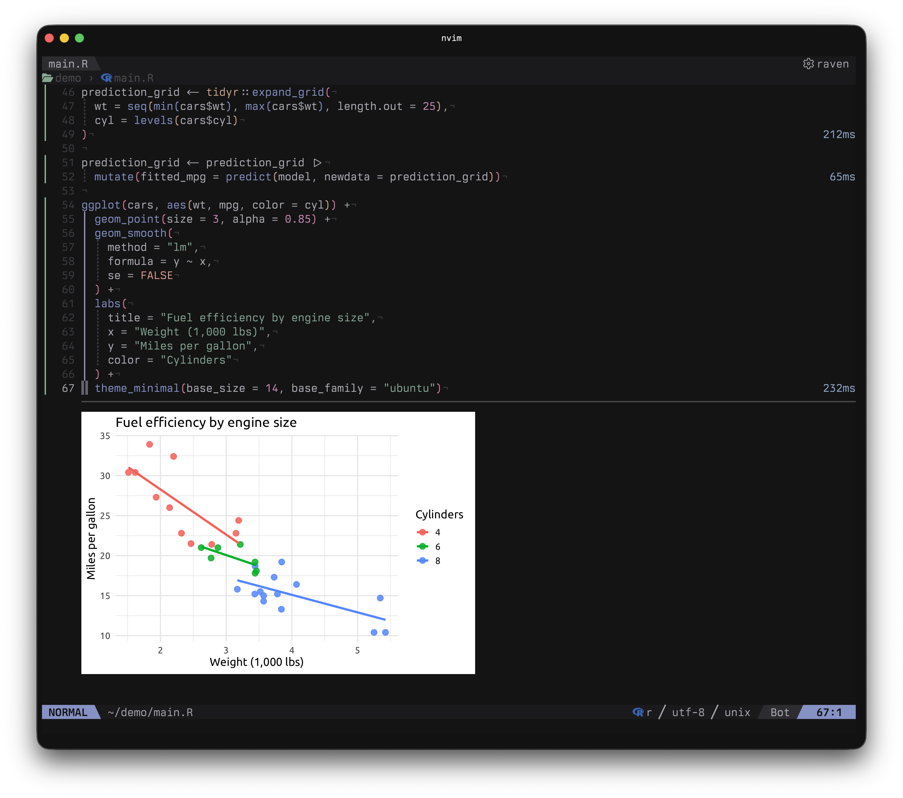
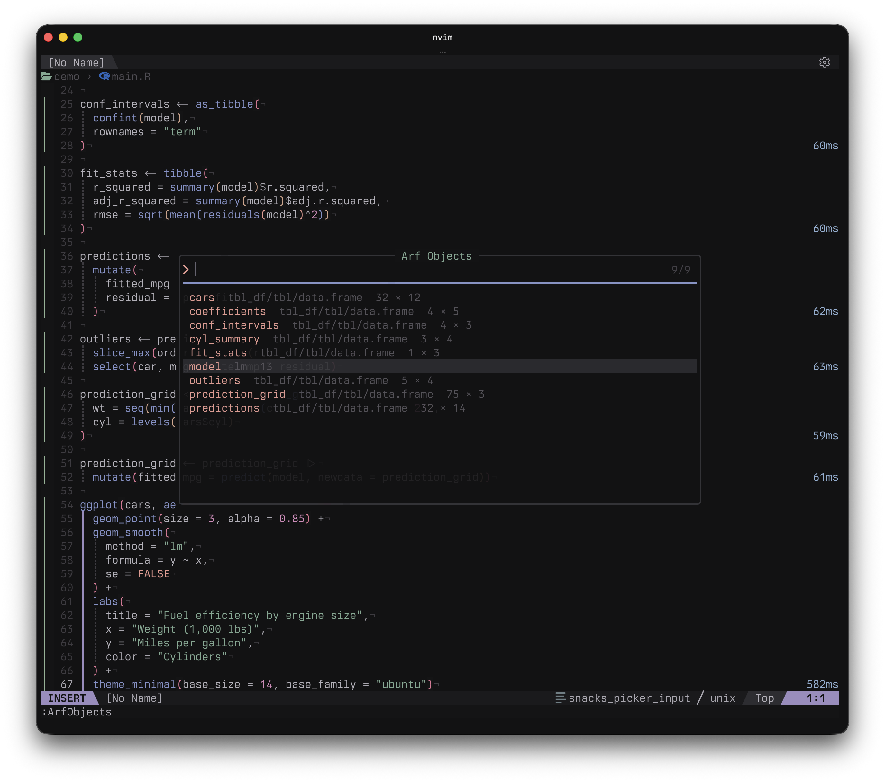
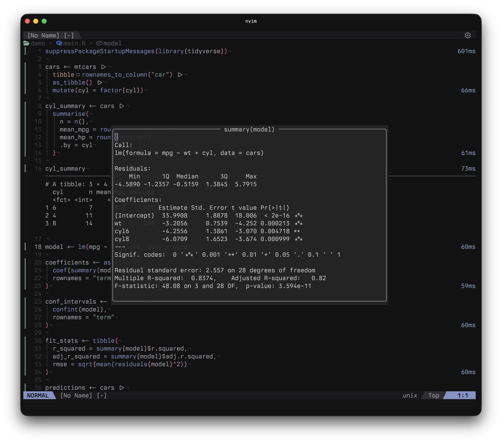

# arf.nvim

<p align="center">
  
</p>

English | [日本語](README.ja.md)

**R code and results, together in Neovim.**

Run expressions from `.R` files and see text and plots directly below your code.
Powered by [arf](https://github.com/eitsupi/arf).

<p align="center">
  
</p>

- Run an expression, selected lines, or the whole buffer.
- Keep R objects between runs with an automatically started session.
- Read saved output, inspect objects, and copy plots.
- Show `summary()` for the object under the cursor. Use `inspect()` to call `str()` or model diagnostic functions too.
- Read R help in a float, including while R is running.
- Keep source files untouched; results live in virtual lines.

## Requirements

- **Neovim 0.12+**, **R**, and **[arf](https://github.com/eitsupi/arf) 0.7.1+** on your PATH.
- **R Tree-sitter parser** for expression selection and running the whole buffer.
- For inline plots: **[Snacks](https://github.com/folke/snacks.nvim)** with `image` enabled, **ImageMagick**, and a compatible terminal such as **Ghostty** or **Kitty**.
- For the object picker: **Snacks.picker**.
- For copying plots: **osascript** on macOS, **wl-copy** (Wayland) or **xclip** (X11) on Linux, or **PowerShell** on Windows.

## Installation

With [lazy.nvim](https://github.com/folke/lazy.nvim):

```lua
return {
  "topazape/arf.nvim",
  version = "*",
  ft = "r",
  dependencies = {
    { "folke/snacks.nvim", opts = { image = { enabled = true } } },
  },
  opts = {},
  keys = {
    { "<LocalLeader>fr", "<Cmd>ArfRun<CR>", ft = "r", desc = "Run R expression" },
    { "<LocalLeader>fr", ":ArfRun<CR>", mode = "x", ft = "r", desc = "Run selected lines" },
    { "<LocalLeader>fR", "<Cmd>ArfRunAll<CR>", ft = "r", desc = "Run all R expressions" },
    { "<LocalLeader>fs", "<Cmd>ArfStop<CR>", ft = "r", desc = "Stop R session" },
    { "<LocalLeader>fy", "<Cmd>ArfCopyPlot<CR>", ft = "r", desc = "Copy latest plot" },
    { "<LocalLeader>fc", "<Cmd>ArfClear<CR>", ft = "r", desc = "Clear results" },
    { "<LocalLeader>fo", "<Cmd>ArfOutput<CR>", ft = "r", desc = "Open saved output" },
    { "<LocalLeader>fk", "<Cmd>ArfSummary<CR>", ft = "r", desc = "Inspect R object" },
    { "<LocalLeader>fl", "<Cmd>ArfObjects<CR>", ft = "r", desc = "List R objects" },
    { "<LocalLeader>fh", "<Cmd>ArfHelp<CR>", ft = "r", desc = "Open R help" },
    { "<LocalLeader>fi", "<Cmd>ArfInterrupt<CR>", ft = "r", desc = "Interrupt R" },
  },
}
```

Already use Snacks? Add `image = { enabled = true }` to its existing options.

## First run

Open an `.R` file in your R project's directory:

```r
x <- mtcars
head(x)
plot(x$mpg, x$wt)
```

Place the cursor on each line and press `<LocalLeader>fr` in order. The first run starts R automatically; later runs reuse the session. Assignments usually produce no text.

`<LocalLeader>` defaults to `\`: press `\fr` to run. Select lines in Visual mode and use the same keys to run a range.

- `<LocalLeader>fo` opens saved text at the cursor. Search with `/`, copy with `y`, and close with `q`.
- `<LocalLeader>fc` clears results; R objects remain.
- `<LocalLeader>fi` interrupts evaluation while keeping the session.

To go further:

- `<LocalLeader>fR` or `:ArfRunAll` runs the whole buffer.
- `<LocalLeader>fy` or `:ArfCopyPlot` copies the latest saved plot.
- `<LocalLeader>fs` or `:ArfStop` ends the automatically started session and clears its results.

## Inspect objects

Press `<LocalLeader>fl` (`\fl` with the configuration above), or run `:ArfObjects`, to search objects in the current R session with Snacks.picker.
Press `<CR>` for a summary or `p` in Normal mode to print the selected object.
Automatically started sessions fetch metadata through a dedicated handler with a five-second execution deadline. Existing sessions selected with `pid` keep the evaluation-based lookup.

<p align="center">
  
</p>

After running the code that creates an object, place the cursor on its name and press `<LocalLeader>fk` (`\fk` with the configuration above), or run `:ArfSummary`. This shows the result of `base::summary()` in a float. Press `q` to close it.

<p align="center">
  
</p>

With `inspect()`, choose the R function to apply to the object under the cursor. Bind keys to `str()` for its structure or a model assessment function for evaluation metrics. Add these entries to your lazy.nvim `keys` table:

```lua
return {
  "topazape/arf.nvim",
  opts = {},
  keys = {
    {
      "<LocalLeader>ft",
      function() require("arf").inspect("utils::str") end,
      ft = "r",
      desc = "Inspect R object structure",
    },
    {
      "<LocalLeader>fp",
      function()
        require("arf").inspect("performance::model_performance", {
          title = "Model performance",
        })
      end,
      ft = "r",
      desc = "Inspect model performance",
    },
  },
}
```

The function receives the object as its only argument, and its text output appears in a float. Install the package before using `package::function`; `library()` is unnecessary. You can also pass the name of a function defined in the session. See `:help arf-inspect` for examples with additional arguments.

## Read R help

Place the cursor on a function name and press `<LocalLeader>fh` (`\fh` with the configuration above), or run `:ArfHelp`. Specify a topic with `:ArfHelp stats::lm`. The help page opens as Markdown in a float: scroll normally, search with `/`, and close with `q`. If several packages have a matching topic, choose one from the selection prompt.

Help is read from the R session's installed packages without evaluating R code, so it remains available during a computation. No additional plugin is required. Unlike R's `?`, unqualified topics are not resolved by package attach order; use `package::topic` to select a package. See `:help arf-help` for details.

## Configuration

Defaults work without configuration. Change only what you need in the lazy.nvim `opts` table:

```lua
opts = {
  inline = { max_lines = 10, border = "rounded" },
  float_window = { width = "80%" },
  output = { tibble = { max_rows = 100 } },
}
```

<details>
<summary>All options and defaults</summary>

```lua
require("arf").setup({
  executable = "arf",
  pid = nil,                -- omitted: auto-start; number: external; false: reset
  startup_timeout_ms = 10000, -- 10 seconds
  eval_timeout_ms = 300000, -- 5 minutes per evaluation

  output = {
    max_bytes = 1048576,      -- retained text per evaluation, including errors
    tibble = {
      max_rows = "inherit",     -- "inherit" or a positive integer
      width = "auto",           -- "inherit", "auto", positive integer, or "all"
    },
  },

  inline = {
    max_lines = 20,           -- body lines, excluding borders, notices, and images
    border = "line",          -- "rounded", "single", "double", "line", or "none"
  },

  float_window = {          -- shared by output, inspections, and R help
    width = "60%",            -- "auto", positive integer, or "1%" to "100%"
    max_height = 30,
  },

  image = {
    render = {                -- PNG generated by R
      width_px = 1200,
      height_px = 800,
      dpi = 180,
    },
    display = {               -- display limits in terminal cells
      max_width = 100,          -- columns
      max_height = 30,          -- rows
    },
  },

  theme = "default",        -- "default", "auto", or "neon"

  signs = {
    enabled = true,
    priority = 5,
    range = { text = "│" },
    success = { text = "│", hl = "ArfSignSuccess" },
    error = { text = "│", hl = "ArfSignError" },
    interrupted = { text = "│", hl = "ArfSignInterrupted" },
    running = {
      text = "…",               -- static symbol when animation is disabled
      hl = "ArfSignRunning",
      frames = { "⠋", "⠙", "⠹", "⠸", "⠼", "⠴", "⠦", "⠧", "⠇", "⠏" },
      interval_ms = 80,         -- milliseconds
    },
  },
})
```

</details>

`eval_timeout_ms` limits the IPC response wait. If R is still running after a timeout, arf.nvim keeps the session busy until capture cleanup finishes. Use `:ArfInterrupt` to interrupt that evaluation, or `:ArfStop` to terminate an automatically started session.

`inline.border` accepts `"line"` (default), `"single"`, `"rounded"`, `"double"`, or `"none"`. Enclosed previews clip long lines to fit the narrowest window showing the buffer in the current tab. Open `:ArfOutput` to read the full retained text.

See [the help](doc/arf.txt) (`:help arf`) for all settings, commands, custom inspection, and troubleshooting. Full defaults: `:help arf-configuration`.

## Project philosophy

Built with AI-assisted “vibe coding” for my own R workflow. I’m keeping the scope small; feel free to fork it for your own needs.

## License

[MIT](LICENSE) © 2026 topazape.
